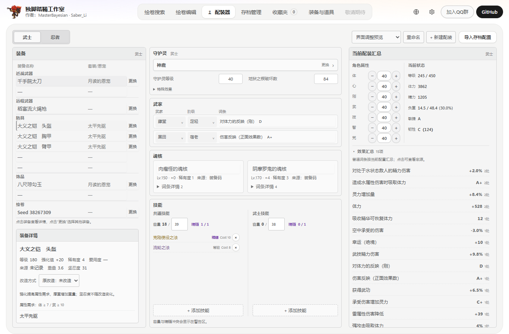
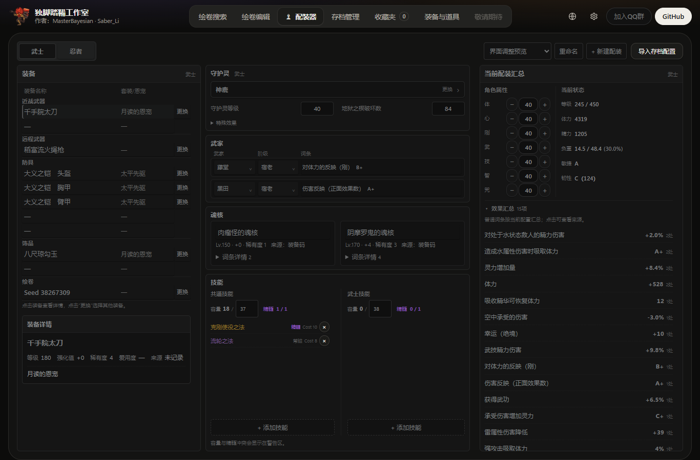

# Persistent loadout planner: data and review guide

The planner is integrated onto upstream v0.8.9 main (a9c20ef50bd405ce1d738430ed5834973831e74c). Its UI and calculations are local planning operations. Saved-inventory/configuration import is read-only; named drafts use versioned local storage.

## Feature scope

Equipment from saves, favorites and N3E1 codes; independent Samurai/Ninja configurations; attributes and derived level; per-style guardians; individual clan effect choices; two soul cores; skills; effect/source summaries and set/grace tiers; armor requirements/remodel simulation; weight/capacity, agility/toughness and bounded ordinary maximum Life/Ki. Zero-plus armor cannot select remodel modes.

New UI strings use Chinese fallback pending English/Japanese translation. Save import skips guardian selection/ownership and clan-rank cache fields. Additional saved records remain internal. Skill effects are excluded from totals by product decision. Attack/defense calculation is outside scope. Life/Ki omit unrepresented fixed rewards, level sync and temporary combat/context multipliers. Native/static and synthetic checks do not imply complete live-game acceptance.

## Complete research/source handoff

[Download the immutable handoff archive](https://github.com/RUAAVICTOR/Nioh3-Scroll-Generator/blob/8b8bc4dac54421eff7c2e8de423a126d66b4fbdd/deliverables/loadout-maintainer-handoff-pc-v202-20261014-v1.zip) from the companion branch. It contains all required research inputs/helpers, native numeric tables, bounded code/control evidence and a full pre-integration v0.8.8 source snapshot. The current feature source is this PR, not that historical snapshot.

- Companion commit: 8b8bc4dac54421eff7c2e8de423a126d66b4fbdd
- ZIP bytes: 25500801
- ZIP SHA-256: d5489cc3476f2e9f7a7bcfacc0bc4de2e8d5c5b6f726485f3bfe0fc5f65c1408
- 2,596 archived files verified against the checksum manifest.
- [Readable tables](loadout-v202/tables/README.md): 12 CSVs / 17,028 rows.
- [Input/generator/asset map](loadout-v202/source-map.json): paths under the extracted archive project-source.

The artifact is stored on a separate branch to keep the full duplicate source snapshot and binary ZIP out of the feature branch history. No private saves, full game executable/sections, dependency environments or new Studio EXE are included. Existing tracked upstream support binaries retain their original notices. Receiver-side code replay checks only the included bounded windows; full-section hashes remain recorded provenance.

## Rebuild the current PR data

Prepare Python using requirements-dev.txt and Node 22 or newer. Unzip the archive, then from this repository root run through the project Python runner:

~~~powershell
./tools/run_python_tests.ps1 -Python <prepared-python> -ScriptPath tools/reproduce_loadout_data.py -ScriptArgument @(
  '--handoff-root', '<extracted-handoff-root>',
  '--output', '<fresh-build-directory>/loadout-replay'
)
~~~

The tool copies the research bundle into a new output, overlays current projection/source files, rebuilds the native catalogs, runs guardian/clan validators and regenerates all ten current runtime JSON assets. Python opens and Node reads/writes are restricted to the isolated replay plus installed Python runtimes. Expected result: ten canonical byte-identical assets in reproduction.json. CRLF/LF is normalized for cross-platform Git checkouts; raw-byte matches and both raw hashes are also recorded. Runtime application use does not require the handoff or live extraction.

## Validation and review

- Current-main TypeScript typecheck, regenerated contracts and 2,028-message locale audit pass.
- Full source test suite: 231 pass, one existing optional test skipped.
- Five Rust save-loadout parser tests and all three synthetic save-host character/transaction/audit tests pass.
- [81 browser checks](loadout-v202/browser-checks.json) cover all three locales, light/dark, constrained widths, pointer/keyboard/touch controls, remodel modes, persistence boundaries and cancellation.
- The current-PR replay reproduces all ten runtime assets after line-ending normalization (six raw-byte matches; four differ only by CRLF/LF).
- No new EXE build or native/game-menu acceptance is claimed.

Review the non-generated planner TS domains, additive Rust save projection and their tests first. Large JSON/CSV changes are the reviewed generated native datasets. Calculation contracts are under docs/knowledge/LOADOUT_*.md. Existing research PRs [#38](https://github.com/Master-Bayesian/Nioh3-Scroll-Generator/pull/38), [#39](https://github.com/Master-Bayesian/Nioh3-Scroll-Generator/pull/39), [#40](https://github.com/Master-Bayesian/Nioh3-Scroll-Generator/pull/40) remain related references, not assumed merged prerequisites.

