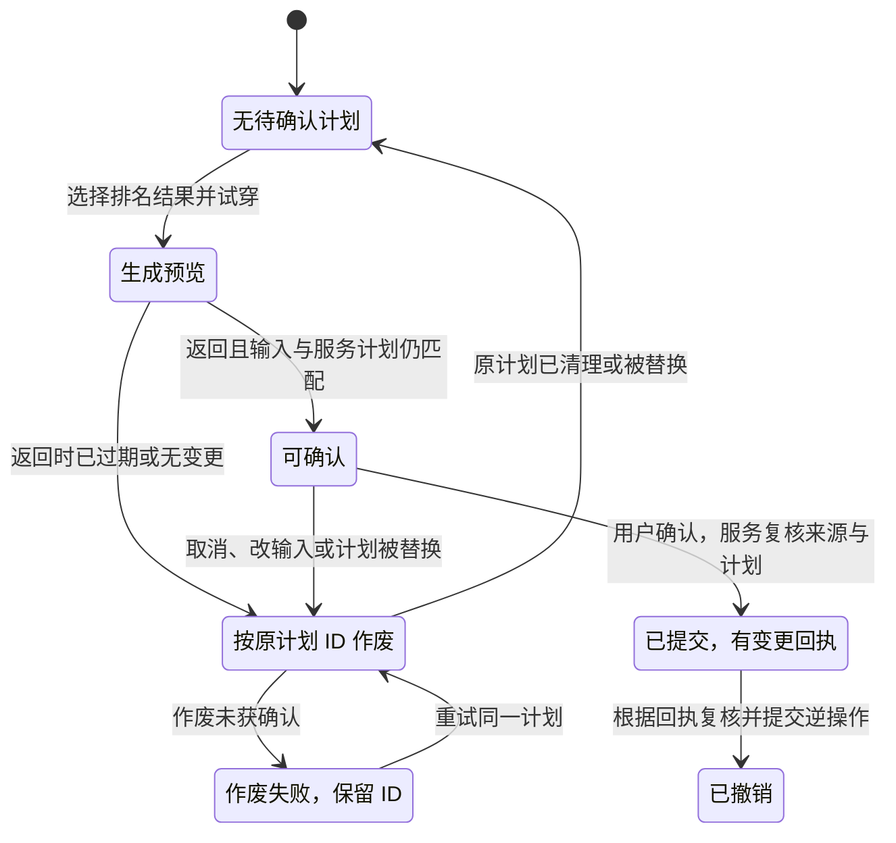
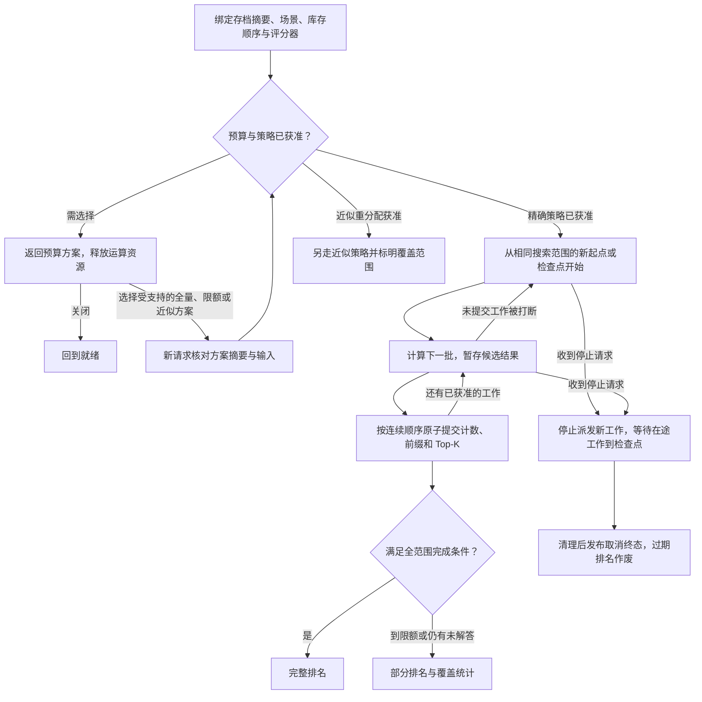
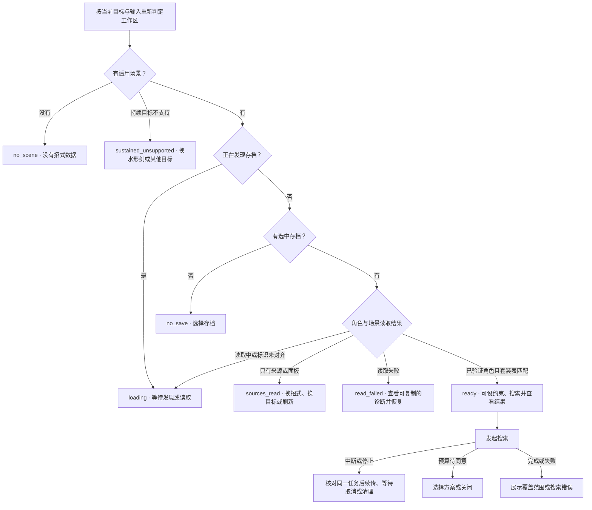

# 优化器怎样排名、试穿与恢复

[伤害手册](./README.md) · [属性与曲线](./CURVES.md) · [原生证据索引](#sources)

## 试穿、确认与逐字节撤销

**打开试穿预览时，存档尚未提交。** 确认只属于当时查看的那份存档、输入和服务端计划。若你在等待时切换了角色或改了搜索条件，回来较晚的预览会被作废；新页面里其他操作创建的计划不受影响。



预览必须等于打分时的**实际槽位布局**。比如把备用武器换到主手，原主手要移回备用槽；清空第二饰品与保持原样也是两种操作。撤销回执要能恢复换下、移位、清空的每个槽位以及独立的第 15 槽绘卷。恢复身份不匹配时，旧回执不能授权本次写入。作废暂时失败会保留原计划 ID，可重试清理。[实现与模型，来源 11](#sources)

`LoadoutPreparedWear.tla` 的 `UndoRestoresBefore` 检查有限模型中整套槽位的前后相等。`loadout_wear_e2e.rs` 另外对**合成加密存档**执行确认、重读、撤销，直接断言整文件字节等于原始字节。前者验证状态空间，后者验证这些具体文件；二者的证据范围都写在测试中。[来源 11](#sources)

## 精确搜索、预算与取消

「排名已经显示」「预算已用完」和「整个搜索范围已经算完」有不同含义。独立搜索器用一个连续的**检查点前缀**记录已提交的工作；Workshop 另有一层协议管理预算询问、取消和网络回执。下图的上半段对应任务协议，下半段对应精确搜索检查点。[来源 12](#sources)



- **什么才算完整？** `StandaloneExactSweep.tla` 的 `AtomicPrefix`、`WeightedCoverage`、`RestoredTopK` 和 `CompleteRequiresEveryAnswer` 要求每个实际配装只进一个统计桶，恢复后的排名包含同一前缀的所有应有候选。前缀须到终点，且没有因来源未算、原生拒算或无已覆盖路径而悬空的候选。已证明不可能入选和明确超出约束的候选可单列。花完有限预算只说明抵达预算边界。
- **为什么已算数量会大于代表数？** 一个代表可以对应多套已证等价的实际装备组合；覆盖按实际套数计，包括区分左右饰品槽和两件不同的实体副本。尚未提交的乱序结果可以丢弃重算，不能只推进游标、漏记排名或重复提交。同一检查点只能恢复原域。
- **点了取消为什么还在等？** `LoadoutSearchControl.tla` 单独建模请求确认前的取消、检查点观察停止和资源清理。预算提示不占运算资源。方案摘要、存档或场景改变后，旧同意无效；原任务只交付一个终态，已作废的终态不能重新打开预算框或排名。近似重分配结果不可宣称全域精确最优。[来源 12](#sources)

## Workshop 的每个页面状态

下图展示界面实际可渲染的七种工作区。内部搜索还分为就绪、搜索中、正在取消、中断、待预算选择、已取消、已完成及搜索失败；这些状态可继续共用同一份已核对的角色面板。[来源 13](#sources)



页面选择由 `loadoutWorkspaceView` 决定。未发现合适的招式时优先报告缺少场景；只有来源时应说明是「已核对面板，当前招式尚不能算」，还是「重建数值与读数不符」。若水形剑因新发动的琢技一直不扣精力，可换有限开场。读取失败可查看原始诊断；搜索失败通常仍有可重试的有效上下文。[来源 13](#sources)

中断时保留继续或停止的意图。同一请求必须匹配存档 ID 和摘要、场景包、角色上下文、输入键与请求标识；进度还核对任务 ID、尝试次数及递增序号。取消期间迟到的排名要作废。只有状态为 `Completed` 且仍满足所有绑定，才能进入试穿；搜索完成状态本身也不保证全域最优。综合实战用主场景筛选后，再比较入围配装在已核实场景中的加权成绩。[来源 12、13](#sources)

<a name="switchglaive-live"></a>
## 转变燎原的道场抓包

下表摘录同场 15 帧的 MAIN 入包攻击值、伤害输出和目标 HP 写回。倍率列按层数显示。第 13 帧有 MAIN 输出，目标 HP 未变。紧接的第 14、15 帧为五层终结技，两段进入 MAIN 时均为零层，合计扣除 10,130 HP。[来源 14](#sources)

| 帧 | 动作 ID | 层数 | 倍率 | 攻击包 `+08` | MAIN 物理／属性／总伤 | 目标 HP 前 → 后 | HP 变化 |
| ---: | ---: | ---: | ---: | ---: | --- | --- | ---: |
| 1 | 25036 | 0 | — | 2821 | 1131／0／1131 | 56522 → 55391 | −1131 |
| 2 | 25036 | 0 | — | 2821 | 1131／0／1131 | 55391 → 54260 | −1131 |
| 3 | 25318 | 0 | — | 2843 | 2596／0／2596 | 54260 → 51664 | −2596 |
| 4 | 25036 | 1 | 1.10 | 3103 | 1342／0／1342 | 51664 → 50322 | −1342 |
| 5 | 25318 | 1 | 1.10 | 3127 | 3016／0／3016 | 50322 → 47306 | −3016 |
| 6 | 25320 | 2 | 1.15 | 3244 | 3404／0／3404 | 47306 → 43902 | −3404 |
| 7 | 25036 | 3 | 1.20 | 3385 | 1502／0／1502 | 43902 → 42400 | −1502 |
| 8 | 25036 | 3 | 1.20 | 3385 | 1502／0／1502 | 42400 → 40898 | −1502 |
| 9 | 25318 | 3 | 1.20 | 3411 | 3356／0／3356 | 40898 → 37542 | −3356 |
| 10 | 25320 | 4 | 1.25 | 3526 | 2974／0／2974 | 37542 → 34568 | −2974 |
| 11 | 25036 | 5 | 1.30 | 3667 | 1641／0／1641 | 34568 → 32927 | −1641 |
| 12 | 25036 | 5 | 1.30 | 3667 | 1641／0／1641 | 32927 → 31286 | −1641 |
| 13 | 25318 | 5 | 1.30 | 3695 | 3663／0／3663 | 31286 → 31286 | 0 |
| 14 | 25389 | 0 | — | 2821 | 751／0／751 | 31286 → 30535 | −751 |
| 15 | 25391 | 0 | — | 2821 | 9379／0／9379 | 30535 → 21156 | −9379 |

<a name="soul-purge-live"></a>
## 宿心升华符与修罗符的六帧实测

**实机已验证。** PC v2.02 同一目标的六个完整命中各有 MAIN 入口、MAIN 输出和 HP 写回。站位和施术顺序由操作者记录，状态键与数值由抓包核对。相对伤害以第 2 帧为基准。[来源 17](#sources)

| 帧 | 毫秒 | 条件 | 动作 ID／物理、属性动作值 | 攻击包 `+08` | 聚合 `+7C` 位值 | MAIN 物理／属性／总伤 | HP 变化 | 相对伤害 |
| --- | ---: | --- | --- | ---: | --- | --- | ---: | ---: |
| 1 | 13641 | 背面基线 | 25036／28、18 | 2821 | `0x3F800000` | 1455／0／1455 | −1455 | 1.286472× |
| 2 | 16391 | 正面基线 | 25036／28、18 | 2821 | `0x3F800000` | 1131／0／1131 | −1131 | 1.000000× |
| 3 | 19891 | 宿心升华符 | 25036／28、18 | 2821 | `0x3FB9999A` | 1640／0／1640 | −1640 | 1.450044× |
| 4 | 23500 | 宿心升华符＋修罗符 | 25036／28、18 | 2821 | `0x400DB4A2` | 2505／0／2505 | −2505 | 2.214854× |
| 5 | 24234 | 双符后续段 | 25037／22、12 | 2821 | `0x400DB4A2` | 2028／0／2028 | −2028 | 1.793103× |
| 6 | 24750 | 双符后续段 | 25037／20、12 | 2821 | `0x400DB4A2` | 1866／0／1866 | −1866 | 1.649867× |

类型 0 的原指令 `A708D0` 将对象 `+A8` 乘入聚合 `+7C`。宿心升华符 `0x17D` 的 `+A8` 为 `1.4500000476837158`（`0x3FB9999A`）。修罗符 `0x312` 的来源为 `0x155`，本次选定 `STAT+1C4` 为 635，`+A8` 为 `1.5269999504089355`（`0x3FC374BC`），竞争值 `+AC` 为 `1.399999976158142`（`0x3FB33333`）。两对象以各自状态键进入聚合，单精度乘积为 `2.2141499519348145`（`0x400DB4A2`）。按加法叠增量会得到 `1.9769999980926514`（`0x3FFD0E56`）。MAIN 在 `78F340–78F36D` 将聚合值送入物理、属性早期池，`6267D0` 对本组数值加上 `f32(+7C − 1)`。双符的池内增量为 `1.2141499519348145`（`0x3F9B6944`）。[来源 4、7、17](#sources)

攻击方活动树在第 1、2 帧为空，第 3 帧有 `0x102`（类型 34，`+A8` 整数 300）和 `0x17D`，第 4–6 帧另有 `0x312` 与受伤惩罚 `0x347`（类型 1，来源 `0x172`）。目标活动树六帧为空。双符帧攻击方 `+3C/+40` 为 `1.2000000476837158`（`0x3F99999A`），其余已读取聚合项 `+38/+78/+80/+84/+88` 及动作状态 `+E98/+E9C` 六帧均为 `1.0`（`0x3F800000`）。逐对象字段和剩余计时见原始解析。[来源 17](#sources)

**爱用度与伤害边界。** 主、备用武器的已捕获装备记录 `+14` 在六次命中间保持各自原值，两条初始满值记录都是原始整数 99900。命中包攻击力差值为 0。本轮实证覆盖 999 档的状态倍率和命中时的攻击值。施法瞬间的爱用度写入及后续面板刷新没有采样，无法给出确已清零后的攻击力降幅。第 1–4 帧动作和伤害参数行一致，背面基线比正面高 28.65%，单符和双符的同招实测分别高 45.00% 和 121.49%。第 5、6 帧复现双符聚合位值，伤害比同时包含动作值差异。其他爱用度档位仍沿用静态曲线。本轮属性伤害为零。[来源 17](#sources)

<a name="versatility-live"></a>
## 多才多艺与素盏七件的 16 帧实测

**实机已验证（1–4 层状态、3 层同招伤害、3 层叠修罗符）。** PC v2.02 共记录 16 个 MAIN 入口，其中 14 个能配对原 MAIN 输出与目标 HP 写回，14 个扣血值均与总伤一致。第 13、14 帧只有入口观测。16 帧攻击方内嵌和外部 STAT 的 `D+0xAAC` 均为 `0.20000000298023224`（`0x3E4CCCCD`）。[来源 18](#sources)

| 帧 | 毫秒 | 动作 ID | 动作值 物／属 | 层／状态键 | 对象 A4／A8／AC | 聚合 +7C | 攻击 +08 | MAIN 物／属／总 | HP Δ |
| ---: | ---: | ---: | --- | --- | --- | ---: | ---: | --- | ---: |
| 1 | 1250 | 25036 | 26／16 | 0／— | — | 1 | 2975 | 987／0／987 | -987 |
| 2 | 5172 | 25040 | 40／24 | 0／— | — | 1 | 2975 | 1437／0／1437 | -1437 |
| 3 | 6000 | 25278 | 22／22 | 0／— | — | 1 | 2975 | 795／0／795 | -795 |
| 4 | 7140 | 25388 | 23／16 | 1／0x3f9 | 0／1.042000055／0 | 1 | 2975 | 1625／0／1625 | -1625 |
| 5 | 7672 | 25388 | 24／16 | 2／0x206 | 0／1.084000111／0.200000003 | 1 | 2975 | 1754／0／1754 | -1754 |
| 6 | 8281 | 25388 | 26／16 | 2／0x206 | 0／1.084000111／0.200000003 | 1 | 2975 | 1881／0／1881 | -1881 |
| 7 | 9625 | 25376 | 25／18 | 2／0x206 | 0／1.084000111／0.200000003 | 1 | 2975 | 1817／0／1817 | -1817 |
| 8 | 9953 | 25376 | 28／20 | 3／0xd8 | 0／1.126000047／0 | 1 | 2975 | 2085／0／2085 | -2085 |
| 9 | 10469 | 25376 | 31／22 | 3／0xd8 | 0／1.126000047／0 | 1 | 2975 | 2656／0／2656 | -2656 |
| 10 | 13203 | 25036 | 26／16 | 3／0xd8 | 0／1.126000047／0 | 1 | 2975 | 1333／0／1333 | -1333 |
| 11 | 15609 | 25036 | 26／16 | 3／0xd8 | 0／1.126000047／0 | 1 | 2975 | 1333／0／1333 | -1333 |
| 12 | 20640 | 25036 | 26／16 | 3／0xd8 | 0／1.126000047／0 | 1.526600003 | 2975 | 1853／0／1853 | -1853 |
| 13 | 24984 | 25396 | 0／0 | 3／0xd8 | 0／1.126000047／0 | 1.526600003 | 2975 | — | — |
| 14 | 26312 | 25562 | 35／15 | 3／0xd8 | 0／1.126000047／0 | 1.526600003 | 2975 | — | — |
| 15 | 26687 | 25562 | 30／14 | 4／0x374 | 0／1.168000102／0 | 1.526600003 | 2975 | 4793／0／4793 | -4793 |
| 16 | 27015 | 25562 | 40／16 | 4／0x374 | 0／1.168000102／0 | 1.526600003 | 2975 | 6158／0／6158 | -6158 |

四个活动状态的 `+A8` 分别是 `1.0420000553131104`、`1.0840001106262207`、`1.1260000467300415`、`1.1680001020431519`。层数按 PC202 的状态键顺序解码。`+A4` 均为 0，`+AC` 只在 `0x206` 为 `0.20000000298023224`，其余为 0。原指令 `2081464` 用 `+A8 × (1 + D[AAC])`，第 1–4 层分别算得约 `1.2504、1.3008、1.3512、1.4016`。第 1–3 帧有七件字段，入口没有活动 `0x6F` 对象。[来源 5、18](#sources)

第 1、10、11、12 帧均为同目标、动作 `25036`、动作值 `26／16`，伤害参数行和两套 D 的字节摘要分别一致，攻击包 `+08` 均为 2975，动作倍率 `+E98/+E9C` 均为 1。第 10、11 帧实测 `1333/987 = 1.350557244`，支持三层因子 `f32(1.1260000467300415 × f32(1 + D[AAC])) = 1.3512001037597656`。按共享未取整基准推算，整倍率乘七件效果给出 1333–1334，只缩放超出 1 的增量给出 1136–1137，无七件缩放给出 1111–1112。[来源 18](#sources)

第 12–16 帧攻击方另有修罗符 `0x312`（类型 0，来源 `0x155`，`+A8 = 1.5266000032424927`，`+AC = 1.399999976158142`）和受伤惩罚 `0x347`（类型 1，来源 `0x172`，`+A8 ≈ 1.20`，`+AC ≈ 0.80`）。同期聚合 `+7C = 1.5266000032424927`，`+3C/+40 ≈ 1.20`。全程目标活动树为空。第 12 帧同招为 `1853/987 = 1.877406282`，相对三层为 `1853/1333 = 1.390097524`。按原指令，两项正增量相加得 `1 + 0.3512 + 0.5266 ≈ 1.8778`。按共享未取整基准推算，加算给出 1853–1855，直接相乘 `≈ 2.062742` 给出 2035–2037。四个同招结果可共享的未取整基准区间约为 `[987, 987.2705)`。[来源 4、5、18](#sources)

**证据范围。** 池因子由实机字段和原指令复算，抓包点是 MAIN 入口与输出。1、2、4 层有实机状态值，3 层有同招伤害对照。5–9 层沿用静态数据。拆下套装、单开修罗符、单用刚力丹及刚力丹叠层的实机对照仍待补齐。整段 MAIN 回放仍待验证。原始导出内嵌的清理快照早于最终清理，同一会话的退出回执记录 `cleanup_verified=true` 且断点列表清空。[来源 18](#sources)

<a name="sources"></a>
## 证据索引

路径以相应仓库或研究归档根目录为起点，可用文件名、符号或 RVA 定位。优化器代码基线为 `234f4b98ffb9248ce4413d2af81333788ac69143`。历史研究回执属于对应快照，部分只保存在本地研究归档。来源 14、15、17 的归档路径相对于 `live-buff-verify-20261123/`。等级摘要的 `owned_inventory[].page` 记录本地核验归档路径，并保留对应页的 SHA-256。这里保留输入指纹、测试名和可复核的表值，手册不附游戏镜像或角色存档。

| 来源 | 可核对的位置 | 证明范围 |
| --- | --- | --- |
| 1 | `docs/product/required-set-loadout.md`；`crates/nioh3-loadout/src/{pipeline,source_rebuild,stat_words,damage}.rs` | 评分目标、重建顺序、字段合并、分量和命中顺序。 |
| 2 | `pipeline.rs` 的 `aggregate`、`side_entry`、`set_rewards`、`slot15`、`add_slot15_attack`；`crates/nioh3-loadout/tests/fixtures/README.md` 中的 Physical assignment oracle | 档位门槛、表标记、备用来源、装备实体与绘卷。 |
| 3 | 研究归档 `research/damage/docs/NIOH3_DAMAGE_FORMULA_ZONES_20261022.md`（文档摘要 `e3039e2662bd9ea8013a8b1284e454ad8e3a7fe08964178778f168db25e53c0a`）、`NIOH3_SITUATION_OPTIMIZER_20261023.md`；`tests/fixtures/loadout_witnesses.jsonl` | 指定攻击的表达式与条件对照、哪些读数来自游戏。 |
| 4 | `r16-native-buffs-20261019/stacking/REPORT.md`；`optimizer-action-buff-20261121/rea-source-rules/SOURCE_STATUS_RULES.csv`（SHA-256 `255e8baf8b39efcd29203aa92bc36dbb1392f7d28644a9fbefcd3f9b8147d6b5`）；`crates/nioh3-loadout/src/damage_dealt.rs` | 来源到普通状态键与类型的联接、同键竞争、早期池的实际算法。 |
| 5 | PC202 `effect-source-36d8-pc202/names/STATUS_NAMES.json`（SHA-256 `2a26a097631648462a73abaf5d922990b2955d5d0217e90bcdd58475af749ebf`）；原始 `.text/.rdata` 与本页下方地址；实表 `audit_tables.bin` | 多才多艺的名称、九组记录、七件奖励、原生类型查询、标量及其目标池。逐层触发时间不在数值片段的证明范围。 |
| 6 | `crates/nioh3-loadout/src/{arts_proficiency,water_sword,event_program}.rs`；`docs/product/loadout-plan.md` 的 Arts activation；`common-trigger-family-20261121/README.md` | 琢技与切流派触发各自的主体、包字段、上限和扣费阶段。 |
| 7 | `crates/nioh3-loadout/src/{peak_prepared,peak_prepared_tables}.rs`；`peak-spells-20261122/weakness/NATIVE_AGGREGATE.json`；`peak-providers-20261121/target/README.md`；`data/loadout/catalog.json`；`r16-native-buffs-20261019/catalog/e2e-batch-01/skills/SKILL_SOURCE_CATALOG.json` | 施术与受术两端、异常组合、背水技能描述符与动作身份。早期物品研究已被较新的克金同组回放补全。 |
| 8 | `crates/nioh3-loadout/src/{agility,pipeline,engine}.rs`，特别是 `field90`、`core_bonus`、`diminished`、`predict_frame`；`crates/nioh3-loadout/tests/fixtures/audit_tables.bin` | 七属性的表列、武器补正、最终重量与容量、分档阈值。 |
| 9 | `crates/nioh3-loadout/src/{sustained,water_sword,sequence}.rs`；`crates/nioh3-loadout/tests/fixtures/water_sword_costs_pc202.json` | 普通薮斩和水形剑的动作顺序、按步扣费与有限开场。 |
| 10 | `tools/translate_loadout_pc202_tier1.py`；`tools/acceptance/verify_loadout_tier1.py`；研究归档 `loadout-kernels-tier1/NATIVE_PARITY.json` | 查表包装函数与原机调用点、三分量对照、击倒计数缺失和投射物爱用度边界。 |
| 11 | `spec/loadout_prepared_wear/LoadoutPreparedWear.tla` 与同目录 README；`apps/workshop/loadout-undo.ts`；`crates/nioh3-protected/src/loadout_wear_e2e.rs` 中 `scored_physical_wear_reread_and_undo_restore_the_entire_encrypted_save` | 状态所有权、退役、按回执还原、合成文件字节相等。 |
| 12 | `spec/StandaloneExactSweep/StandaloneExactSweep.tla`；`spec/loadout_search_control/LoadoutSearchControl.tla`；`crates/nioh3-loadout/src/{exact_sweep,search_control,search_budget}.rs` | 前者规定连续检查点、带权覆盖与完整性；后者负责预算准入、取消仲裁和旧回执。 |
| 13 | `apps/workshop/LoadoutOptimizer.tsx`、`loadout-context-state.ts`、`verify-loadout-product.mjs`；`docs/product/loadout-plan.md` 的 Workshop search goals and recovery | 渲染分支、请求身份、恢复操作和实际按钮。浏览器夹具、打包版 WebView 和实机分别验收。 |
| 14 | 本地核验归档：转变燎原逐帧解析 `capture-swg-20261123-parsed/HITS.json`（SHA-256 `a3da7dd1a062c1c7f45ade665d86b7d907ce09ae90777af0ec2eb768d7788654`） | PC202 训练道场 15 帧，含 1–5 层攻击值、终结技两段 MAIN 入场状态及连贯的目标 HP 读数。 |
| 15 | 本地核验归档：连绵 4 对 0 逐帧解析 `capture-fists-4v0-20261123-224622/HITS.json`、同段字节对照 `capture-fists-4v0-20261123-224622/DIFF_4V0.json`、资源行与倍率指令片段 `capture-fists-4v0-20261123-224622/STACK_RATE_EVIDENCE.json`、CE 清理回执 `capture-fists-4v0-20261123-224622/CLEANUP_PROOF.json` | 动作 25035 四帧含层数、动作倍率与实际扣血。中性初值下执行 MAIN 倍率片段确认入池方式。清理回执记录 `cleanup_verified=true`，会话和全局断点数均为 0。 |
| 16 | 连绵静态分析（本地核验归档 `unbroken-evidence/FINDINGS.md`）、[十层计时参数](./evidence/STACK_PARAMETERS.json)、原始指令（本地核验归档 `unbroken-evidence/ORIGINAL_INSTRUCTIONS.asm`） | 类型、叠层和计时字段、条件分发、事件写入及 MAIN 读值。静态分析的早期记录先于来源 15 的资源行对照。 |
| 17 | 本地核验归档：六帧逐项解析 `capture-soulpurge-20261123-231250/HITS.json`、字节差分与 PC202 原指令 `capture-soulpurge-20261123-231250/DIFF_SOULPURGE.json`、CE 清理回执 `capture-soulpurge-20261123-231250/CLEANUP_PROOF.json`、复算脚本 `capture-soulpurge-20261123-231250/analyze_soulpurge.py` | PC202 会话 `ce-38548`，PID `45528`，六帧十八事件。抓包 SHA-256 `1866fb2adfc608b42d7cd62a9a0f3562d1aa4e90589fbbc8a32f10fbe4a534a3`。重连确认观察器停用、无待清理项、全局及自有断点清零。 |
| 18 | 本地核验归档 `live-sustained-20261123/`：原始抓包 `versatility-live-1-core_main-20261124-034427-057399/capture.json`、逐帧解析 `versatility-live-analysis/HITS.json`、同招差分与原指令 `versatility-live-analysis/VERSATILITY_DIFF.json`、退出清理回执 `versatility-live-1-core_main-20261124-034427-057399/EXIT_CLEANUP.json`、复算脚本 `versatility-live-analysis/analyze_versatility.py` | PC202 会话 `ce-62968`，PID `30328`。抓包 SHA-256 `bb80782e89ea3b76df51d9b182dbe3421ad49c0502422633445ee31b528230d7`。16 个入口、14 个 MAIN／HP 闭合样本。 |

### 关键 RVA 与键

下列 RVA 相对 PC v2.02 模块基址；表中状态键、物品键及偏移都用十六进制。用于复核的原始节指纹见后面的脚本。

| 链路 | 定位 |
| --- | --- |
| 装备 → 来源 → STAT／D | 武器 `818248`，身体 `2FB2BC`，绘卷 `81744C`，套装 `3FAA98`，物化 `819400`。普通命中结算 `78CE8C…79676A`，总／物理／属性输出 `MAIN+218/+224/+228`。 |
| 多才多艺对象 | 九条定义均为类型 `6F`，状态键按准备倍率升序为 `3F9, 206, D8, 374, 2B4, 29A, 178, 1CA, 18F`。工厂 `207F3C0`，构造 `2074E4C` 写对象 `+A8`。普通应用槽 `A70FD0` 直接返回。MAIN 另由 `78F3CA → 78C5CC` 按对象虚方法返回的**类型**查找，并检查活动位。 |
| 素盏七件 | 效果 `CE68` → 来源组 `A953` → 套装 `FB19`。七件奖励行的组 `E2CD`、基础值 200、等级系数 0；`821498…8214B0` 将值乘 0.001 加到 `D+AAC`。活跃对象的 `2081464` 计算 `A8 × (1 + D[AAC])`；若对象没有合格的角色链，按该函数的中性装备项退回。 |
| 早期加算与后段架式 | 多才多艺 `78F42D/78F439` 与普通状态 `78F35C/78F368` 向同一对栈目标（`rbp−48h/−18h`）分别送入因子。架式选 `D+10C/110/114`；琢技主项 `790909…790923` 送后段栈目标 `rsp+30h/+38h`，另有属性／被动专属路径。公共函数 `6267D0` 负责增益累加／减益连乘。 |
| 手甲连绵 | 类型 `0x86` 的层数见 `status+0xA8`，镜像见 `actor+0x934`。条件 `0x3B7–0x3C0` 在 `0xFD603–0xFD60E` 匹配层数。事件分支 `0x678BC8–0x678CC7` 可写动作状态 `+0xE98/+0xE9C`。MAIN `0x78D88C–0x78D8E5` 将正增量送入早期池。四帧整段离线回放均因 `0x78C9A9` 查表输入缺失而中止。 |
| 敌方通道 | 水异常 `209040C` 写目标物理通道，MAIN 在 `7947EC/7947F6` 取物理／属性通道；普通克金 `3DF → 347`，月读 `28A → 347`；混沌键 `2E9/1D8/15` 随档位切换。 |
| 简中名称与来源的复查 | PC202 档案 17 的简中资源 491，升华符的用途文字 ID `02C9F708`，解放符为 `02EF6E3D`；资源 365 中连绵说明 `047D6A34`、转变燎原说明 `04767425`。档案 03 的资源 1072，第 120–129 行是连绵的十个同名状态，第 134 行是死里求生；资源 917 第 417 行是转变燎原。已核对简中资源 365、491 的 SHA-256 前缀 `360ac025f608988d`、`ebd863e6991c9fca`，完整指纹见来源 5 的 JSON。 |
| 背水与死里求生 | 背水之法 `C403 → 2EB6 → D+2AC`；死里求生状态键 `2BF`，其原生 `208F641…208F651` 写攻击方聚合区 `+84`，`78F2B2…78F2CC` 按命中条件读角色 `+2E44` 并送入早期物理池。 |
| 六种反映调用点 | 重量 `791B39`，忍术 `791BB4`，阴阳 `791B78`，敏捷 `791AFA`，击倒 `791ABB`，手持爱用度 `791A70/791A79`。分支包装调用共同查表函数 `2FA678`。 |

<a name="reflection-grades"></a>
### 伤害反映词条等级

- **装备值 → 曲线列。** 原生效果列表的运行时记录在 `81922F–81923B` 将 `u16(+08) + i32(+04)` 作为词条有效值传给 `819400`。忍术反映分支 `81FB9C → 81A2B5` 将该值和现有 `D+70` 取较大值。命中时 `791BA7–791BB4` 读取 `D+70`，跳过负值，将非负值原样传给 `2082A34 → 2FA678`。`2FA7E0` 按该列取原生浮点值，受表行列数及第 17 列上限约束。六条曲线共用这个读列逻辑。原始指令（本地核验归档 `grade-evidence/ORIGINAL_INSTRUCTIONS.txt`）
- **词条有效值 → 界面字母。** 界面格式器 `1BC1A08` 在等级格式分支调用 `22CE144`，对 0–17 返回 `17 − 有效值`。`1BC1A74–1BC1A84` 用这个索引从 `.rdata` RVA `3BDD2E0` 读取 UTF-16 指针，因此有效值 0 显示 D-，17 显示 AAA+。词条名称另由本地化资源提供。REA 6.4.0 / Ghidra 12.1.4（本地核验归档 `grade-evidence/DECOMPILED.json`） · [18 档原始指令回放及字串读取](./evidence/GRADE_CHECK.json)
- **实物记录交叉检查。** 四条保留的 PC202 背包记录包含装备重量 `582F` 原值 2、爱用度 `2E93` 原值 3（两件）、阴阳术术力 `707E` 原值 4。已核对装备记录字节、指纹及 PC202 简中词条名。若有效值没有额外调整，它们依次是 D+、C-、C-、C；这批背包记录没有同屏 UI 字母截图。核验脚本（本地核验归档 `grade-evidence/verify_grades.py`） · [记录及来源](./evidence/GRADE_CHECK.json)

<a name="tables"></a>
### 怎样复核表格

夹具为 `crates/nioh3-loadout/tests/fixtures/audit_tables.bin`，SHA-256 为 `922ba8fa5c1089538c1f075e5600cc65a8310ee4150d12eb4aa34610f3f804c2`。以下 Node.js 代码可从仓库根目录运行，打印六表全部坐标及原生档位。曲线页将同值的忍术、阴阳表合并排版。所有字段均为小端。

<details><summary>展开只读表格校验代码</summary>

```javascript
const fs = require("node:fs");
const crypto = require("node:crypto");
const bytes = fs.readFileSync("crates/nioh3-loadout/tests/fixtures/audit_tables.bin");
const expected = "922ba8fa5c1089538c1f075e5600cc65a8310ee4150d12eb4aa34610f3f804c2";
if (crypto.createHash("sha256").update(bytes).digest("hex") !== expected) throw Error("Unexpected table identity");
const sections = new Map();
for (let pos = 0; pos < bytes.length;) {
  const size = bytes.readUInt32LE(pos);
  const key = bytes.toString("utf8", pos + 4, pos + 4 + size);
  pos += 4 + size;
  const length = bytes.readUInt32LE(pos);
  sections.set(key, bytes.subarray(pos + 4, pos + 4 + length));
  pos += 4 + length;
}
const index = sections.get("grade.index");
const rows = sections.get("grade.rows");
function curve(key) {
  for (let i = 0; i < index.length; i += 12) {
    if (index.readUInt32LE(i) !== key) continue;
    const first = index.readUInt32LE(i + 4);
    const count = index.readUInt32LE(i + 8);
    return Array.from({length: count}, (_, j) => {
      const pos = (first + j) * 84;
      const grades = rows.readUInt16LE(pos + 82);
      return [rows.readInt32LE(pos+4), ...Array.from({length: grades},
        (_, g) => Number(rows.readFloatLE(pos + 8 + 4*g).toFixed(3)))];
    });
  }
  throw Error("Unknown curve " + key.toString(16));
}
for (const key of [0x8e2d, 0x4f75, 0x5731, 0x4354, 0xf361, 0xdd41]) {
  console.log(key.toString(16), curve(key));
}
```

</details>

属性表的 `power90` 行宽 32 字节；心精力、刚的双流派容量、技的琢技输入／忍术力和咒的术力分别取 `+04, +08, +0A, +10, +12, +18` 的 u16。武器换算从带八字节表头的 `base90` 取行内 `+1A`。套装从 `side.keys` 的键／行号对索引 `side.rows`，表头后每行 216 字节；第一个奖励始于 `+30h`，每档 24 字节。

### 怎样复核多才多艺的数值例子

下例需要归档的 2.0.2.0 原始代码节和只读数据节，以及 Python 的 Unicorn 库。它在模拟内存中放入两组已知字段，执行原始取值算术和早期池的正增益路径。输出只回答「给定字段后怎样合并」，不模拟层数生命周期、目标反应或整次 MAIN。

```text
D+AAC=0.00  offer=1.420000  boost=1.570000  cut=1.0
D+AAC=0.20  offer=1.704000  boost=1.854000  cut=1.0
```

<details><summary>展开已离线执行的原始指令片段对照</summary>

```python
from pathlib import Path
from hashlib import sha256
from struct import pack, unpack
from unicorn import Uc, UC_ARCH_X86, UC_MODE_64
from unicorn.x86_const import (
    UC_X86_REG_RAX, UC_X86_REG_RBX, UC_X86_REG_RCX,
    UC_X86_REG_XMM0, UC_X86_REG_XMM1, UC_X86_REG_XMM6,
)

def verify(text_path, rdata_path):
    text = Path(text_path).read_bytes()
    constants = Path(rdata_path).read_bytes()
    assert sha256(text).hexdigest() == "4cec8fb6ad867417a76df8201c1d4f54172443884910463c1953acad91ae6c29"
    assert sha256(constants).hexdigest() == "112be451ab3b2abef3bd90c608bf7853c2607e96250894c82670fabbd74efa81"
    vm = Uc(UC_ARCH_X86, UC_MODE_64)
    for page in (0x2081000, 0x626000, 0x3bd4000, 0x6000000, 0x6001000):
        vm.mem_map(page, 4096)
    for page in (0x2081000, 0x626000):
        vm.mem_write(page, text[page-0x1000:page])
    offset = 0x3bd4000 - 0x38e2000
    vm.mem_write(0x3bd4000, constants[offset:offset+4096])
    bits = lambda value: int.from_bytes(pack("<f", value), "little")
    number = lambda word: unpack("<f", (word & 0xffffffff).to_bytes(4, "little"))[0]
    for field, expected in ((0.0, 1.42), (0.20, 1.704)):
        vm.reg_write(UC_X86_REG_RAX, 0x6000000)
        vm.reg_write(UC_X86_REG_RBX, 0x6001000)
        vm.reg_write(UC_X86_REG_XMM6, bits(1.0))
        vm.mem_write(0x6000aac, pack("<f", field))
        vm.mem_write(0x60010a8, pack("<f", 1.42))
        vm.emu_start(0x208149c, 0x20814b6)
        factor = number(vm.reg_read(UC_X86_REG_XMM0))
        assert abs(factor - expected) < 1e-6
        vm.mem_write(0x6000000, pack("<ff", 1.0, 1.0))
        for incoming in (factor, 1.15):
            vm.reg_write(UC_X86_REG_RCX, 0x6000000)
            vm.reg_write(UC_X86_REG_XMM1, bits(incoming))
            vm.emu_start(0x6267d0, 0x6267e9)
        boost, cut = unpack("<ff", vm.mem_read(0x6000000, 8))
        assert abs(boost - (expected + 0.15)) < 1e-6 and cut == 1.0
        print(f"D+AAC={field:.2f}  offer={factor:.6f}  boost={boost:.6f}  cut={cut:.1f}")

if __name__ == "__main__":
    import sys
    verify(*sys.argv[1:])
```

</details>

### 此次校验覆盖了什么

六种反映及属性样点均从上述实表重新读取。多才多艺的两个算例实际执行了原始指令片段。项目离线计分板 `tools/loadout_scoreboard.py --check` 通过六项要求的保留观测，分布在三个动作键；该基线沿用保留观测。11 月 23 日转变燎原道场抓包的独立范围见来源 14。基线见 `tests/fixtures/loadout_scoreboard.baseline.json`。它覆盖刀强攻的常态／精防／琢技、剑气的常态／精防、水燕返，不能作为九层多才多艺或每个目录动作已经通过实战验收的证据。
