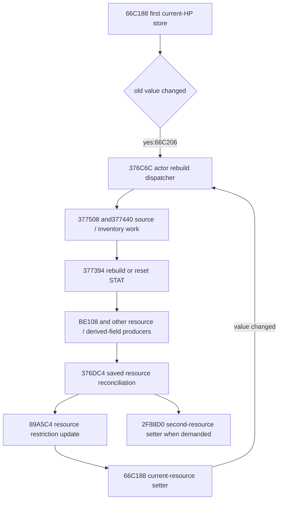

# HP writes, actor rebuilds and resource restoration

RVAs and structure offsets in this record are hexadecimal; case/byte counts are
decimal. Local inferred field names do not establish a game UI label.

The original66C188 setter's first HP store is not necessarily the end of a hit.
Its call at66C206 targets the structured376C6C actor rebuild dispatcher. The
dispatcher recollects sources, may rebuild STAT and updates resource capacities
before reconciling a saved resource snapshot. A final HP oracle must execute or
explicitly refuse these paths. The full327DEC application remains incomplete.

All new work here uses approved PC2.02 captured .text/.pdata/.rdata with the game
closed. It makes no game calls/writes, hook or save changes. Native evidence is
the inherited masked Python instruction interpreter, not hardware execution.
Artifacts reside under the R9 audit root
`D:/Nioh3_v080_deliverables/deliverables/damage-pro-return-audit-20261015-r9/hp-notification-frontier`.

## Byte-backed control flow



This graph records possible original calls, not universal execution or guaranteed
recursion. Raw branches, aliases and actual changed-value tests decide which
edges execute. The no-change first-setter path does not dispatch376C6C.

Complete376C6C spans376C6C..376DC2:342 bytes,81 instructions, SHA256
`28142a0780a59f7a2c5cb24447054b095d6f300add4260a02bfdbaa2b8417392`.
It refreshes actor.kind+24 through3775C0 unless the incoming kind is6; the
**resulting** kind5 skips the rest. Do not apply this gate to the initial kind
without accounting for the actual refresh and entity-tag guards.

The ordered main path calls3769E8,376A44,376AA0 to prepare a snapshot, then
377508,377440,377394,BE108,3771EC,3770D0,377F88,3775F0,376F6C,376F20,85AF4,
and conditionally F3478 before376DC4. Those child bodies and exact callsites are
retained in native-01,children-01 and resource-children-01. Small first-ret leaf
exports are marked partial; cold/unsigned branches are not inferred absent.

377394 checks Q[actor+18] and its byte+68 bit2. The taken path calls818B68 for
actor+25A8 and, if nonnull, the separate pointer atactor+2D90. The other path calls
375948 on those STAT objects. It therefore does not merely dispatch arbitrary
inert listeners. Exact previous source contracts apply only with the matching
object/alias/raw-input identities. Do not equate the first HP argument with
actor+38 solely because actor.owner is a pointer; that alias needs its own binding.

## Complete980BFC capacity setter

`capacity_model.py` and public Stage4 `resource_capacity_setter` implement the
whole original980BFC..980CBA function. Input is a complete known0x50-byte resource
object plus new_capacity_u64. It does not require or fabricate a resource owner,
because this function does not consume that owner pointer.

In original store order:

1. Write resource.u64+18 = new capacity N.
2. If current resource.u64+20 > N, write current=N, using unsigned comparison.
3. Write resource.u64+30=0.
4. If N is nonzero, compute its new field30 value from the actual optional
   parameterD490 and write it. Other object fields are preserved.

The parameter is from **optional_multiplier**, not the effect/group namespace:
keyD490, native row1818, stride32, byte offsetE348, row SHA256
`6faf0251b485c20de472a0d55dd57cbd83dc2d950cde76ace9e4b46a7cb4afe4`.
Actual608508 returns f32(coefficient_i32 * scale_f32), whose value is0.5 here.
The source path is explicitly rooted at R8ROOT after inherited metadata repair.

The nonzero result is:

```text
p = F32(0.5 * native_u64_to_f32(N))
candidate = native_f32_to_u64(p)
resource.u64+30 = min_unsigned64(N-1, candidate)
```

The unsigned float conversion preserves the actual high-bit split, CVTT64 and
2^63 correction. Replacing it with host integer division or signed casts is not
the recovered program. For ordinary N=100, field30 is50; forN=1 it is0. The
native unsigned boundary cases are numerical controls, not legal/reachable
player-HP claims. Field30 is a derived bound, not a claim that the currently
reserved quantity field28 or effective HP automatically equals this value.

`capacity-02/RECEIPT.json` accepts203 whole native returns,20,332 steps,702 ordered
resource stores and112 executed original RVAs. It covers zero, equality/clamp,
binary32 boundaries, u32/u64 high bits and128 deterministic random cases. Its
SHA256 is `d7aff27f9bcc399f9a1c906173d877c2ecab5bc573980ad3410487f598e4bee6`.
The promoted module is byte identical, SHA256
`81a51df423be2b1cdaa5fba32e7db1348be37e12e779aca2758a81531b797d57`.
Actual public Stage4 replay accepts203 complete native-reference JSON envelopes
and eight strict type/extent refusals. Receipt:
`stage4-public-integration/resource-capacity-01/PUBLIC_ACCEPTANCE.json`, SHA256
`46f38c98986a882815c069bf501f3b15f9f2851774f0bbd0ccc8ca8efb342408`.

## Exact rounding used during resource reconciliation

The dispatcher snapshot prefix is also independently implemented as Stage4
`actor_resource_snapshot`. Actual376C6C through before376CEF is compared across
184 original-prefix controls plus one real missing-entity frontier. All40
snapshot bytes and the unchanged owner prefix match, including u64 high-bit
conversions, capacity-zero branches, negative/zero second-resource maxima and
unconsumed NaN current bytes. Public replay accepts all185 complete JSON/exit
envelopes; receipt `stage4-public-integration/resource-snapshot-01/PUBLIC_ACCEPTANCE.json`
has SHA256 `dcd193b734dab7f3ee63acfcf056e44b2ce4edd1b1383f75beb610491e510aca`.
The normalized owner prefix is exactly0xB4 bytes; entity/type refresh for a
consumed nonnull entity is explicitly unclosed, not silently bypassed. Kind6
skips that refresh in actual code, while null entities leave the input kind
unchanged. Resulting kind5 returns before resource reads. This API stops before
all source collection and actor reconstruction; it is not the whole dispatcher.

The first two ratios are F32(native_u64_to_f32(value) / native_u64_to_f32(max)),
using resource current+20 or restricted+28 and maximum+18; zero maximum returns
positive zero. The second ratio is F32(current_f32+14 / maximum_f32+18) only for
positive maximum, otherwise positive zero. The caller saves original capacities,
these ratios and the two explicit resource pointers. Preserve native conversion
order, signed zero and branch-local reads.

376DC4 takes a snapshot containing the first resource pointer, saved capacity,
two f32 ratios and a second resource pointer/value/ratio. When capacity differs,
it forms arguments for89A5C4 and then66C188 using native u64-to-f32 conversion,
ratio multiplication and BA32F0 before the unsigned conversion. The second
resource branch can call2F88D0. Those calls cannot be assumed to preserve all
resource bytes. Earlier whole guardian proofs executed them only in their
declared raw domains; they are not an independent general HP restoration model.

The exact BA32F0/BF02AC finite rule is now checked: **nearest integer, exact
halves away from zero, preserving negative zero**. It is neither truncation nor
round-to-even. The native bit helper was recovered as a bounded direct CFG:
56 instructions/213 bytes within a1024-byte window, with every branch target
accounted for. No game-helper return is substituted.

`rounding-controls-01/RECEIPT.json` accepts2,048 finite raw f32 patterns,130,891
original-instruction steps and73 executed-byte matches. Controls include both
signs, half neighbors, subnormals, negative zero, large integral values and
deterministic random patterns. Exact mask tables and +/-1 constants have .rdata
hashes. NaN/infinity behavior is outside this high-level finite contract. The
actual helper bytes remain available rather than replacing unsupported inputs
with an assumed integer result.

## Complete BE108 HP-capacity producer

Stage4 now exposes `hp_capacity_producer`, the complete originalBE108 function
through its actual return, including its conditional980BFC call. This closes the
base-STAT-to-capacity arithmetic for the declared raw graph, independently of the
still-open outer dispatcher. Seven mandatory inputs carry complete actor bytes
(3650), nullable external STAT(900), entity(896), query prefix(10), query entity
(15E0), world manager(1410) and scene(16A0). Extents here are hexadecimal. Explicit
normalized pointers and inline/external STAT selection are validated; missing
consumed input is unsupported. Unconsumed nullable regions need not be invented.

The base is selected STAT.u32+18. A null/tagged entity or a nonzero directF3FC4
component pointer preserves that base. F3FC4 reads query.entity.Q+15D8; it is not
the4893B8 F3 boolean query. A high-word-only nonzero pointer still takes the real
skip branch. Otherwise the original finite binary32 arithmetic is:

```text
v = native_u32_to_f32(base)
v = F32(v * actor.f32+3648)
v = F32(v * actor.f32+364C)
v = F32(v * actor.f32+30BC)
v = F32(v * category_optional_coefficient)
v = F32(v * entity_mode_optional_coefficient)
v = F32(v * world_count_optional_coefficient)
new_capacity = native_f32_to_u64(v)
```

Actor.u32+20 selects category2/3/4 optional keys8691/5B88/2C7C; other categories
use1. When entity.byte895 is nonzero, category3/4 selectsD61C/EC65, otherwise1.
The last coefficient isD52A only when entity.byte893 is nonzero and the unsigned
comparison of `I64(U64(scene.Q1698-scene.Q1690)) SAR2` is at least2. All parameter
IDs here belong to `optional_multiplier`. Binary32 order, native CVTT64/high-bit
correction and original helper register preservation are part of the contract.
Changing multiplication order demonstrably changes the native result.

Only a changed capacity calls980BFC on actor+38. Equal capacity performs no setter
stores, even if current resource exceeds capacity in the supplied raw prestate.
Do not add a convenience clamp. OptionalD490 is consumed only on a changed,
nonzero capacity. All other actor bytes and external STAT remain unchanged.
One explicit local example with base12345, actor factors1.25/.75/1.5, category3,
active entity/world factors and the actual optional rows produces capacity11804;
this is a raw-input arithmetic witness, not a legal loadout or final hit result.

`hp-producer-controls-04/RECEIPT.json` retains184 whole original returns,
56,145 instructions,240 executed-RVA matches and11 actual missing-input frontiers.
It compares the complete actor/STAT bytes, lookup/call order and all resource
stores. For missing external STAT, the required reader isBE122 while the first
exact numerical demand isBE19A: unknown low bits propagate through MOV/saved
registers; known zero upper32 bits do not make the value known.

The byte-identical promoted module SHA256 is
`26a3d7d18f0f3dbd892205506558a263d7d76b099fc74a76983aef7f62b1eebe`.
Actual Stage4 public replay passes203 whole JSON/exit envelopes (184 native
references,11 raw frontiers and eight invalid-input cases), receipt
`stage4-public-integration/hp-producer-01/PUBLIC_ACCEPTANCE.json`, SHA256
`d2bca3e842d65b8cb0b230f92958466e350fc50ecb938ab4106bd2a1033c2ff3`.
Independent review adds13 original-byte vectors/3,617 instructions/219 RVAs and
nine actual public CLI processes without repeating the old matrix; receipt
`hp-producer-independent-review/REVIEW_RECEIPT.json`, SHA256
`4400296aec083cd95c092f70bcffe6970a1c10a94837d476592067d27fc2d9b6`.
Its rational rounding oracle verifies two actual order discriminators and raw
skip/unknown branches. It found no repair requirement. This is finite-RNE,
normalized-graph interpreter evidence, not current-player or hardware execution.

## Optimizer boundary and next work

The [method reset](NIOH3_DAMAGE_METHOD_RESET_20261015.md) separates these outputs.
For a build maximum-HP constraint, the default research interpretation, require
candidate-correct STAT/source construction and the capacity producer at a
declared rebuild phase. Do not require all post-hit reconciliation callbacks
merely to evaluate that build statistic. A usable/reserved-HP constraint needs
its additional resource semantics explicitly. Actual final HP loss and survivor
HP require the separate application/late-write path. Rebuild-triggered later
source updates must not be applied twice to the single81920E..8193D5 suffix;
another field pass requires an actual further rebuild edge.

Still open: complete376C6C child mutation composition, raw aliases and all live
producer inputs;89A5C4/66C188/2F88D0 joins through real returns; all XMM15
definitions/gates in327DEC; late setters; final hit boundary and combat actions.
The existing full main CFG is already present and should be used before asking
for more data. No final-HP, full formula, legal-optimizer or DPS claim follows
from the accepted local setters and rounding rules.

Replay native controls with PowerShell7 and the prepared project wrapper:

```powershell
$env:PYTHONDONTWRITEBYTECODE = '1'
& 'F:\Nioh3_ScrollEditor\tools\run_python_tests.ps1' -ScriptPath 'D:\Nioh3_v080_deliverables\deliverables\damage-pro-return-audit-20261015-r9\hp-notification-frontier\verify_capacity.py' -ScriptArgument @('--output','D:\Nioh3_v080_deliverables\deliverables\hp-capacity-FRESH')
& 'F:\Nioh3_ScrollEditor\tools\run_python_tests.ps1' -ScriptPath 'D:\Nioh3_v080_deliverables\deliverables\damage-pro-return-audit-20261015-r9\hp-notification-frontier\verify_hp_rounding.py' -ScriptArgument @('--output','D:\Nioh3_v080_deliverables\deliverables\hp-rounding-FRESH')
```
